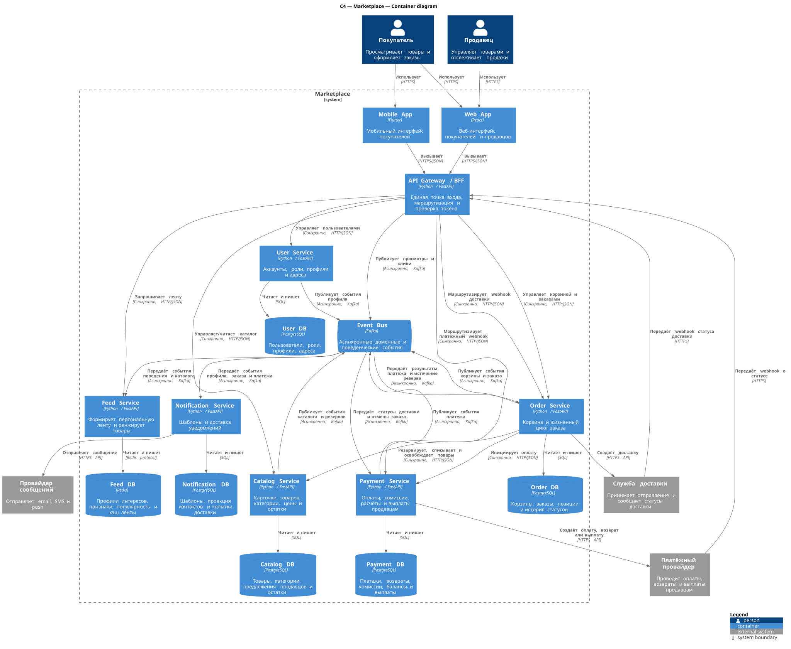

# Маркетплейс: архитектура

## C4 Container diagram

Исходник диаграммы: [`docs/c4-container.puml`](docs/c4-container.puml). Диаграмма показывает границу системы, пользователей, внешние системы, контейнеры, отдельные хранилища и протоколы взаимодействия



## Домены и ответственность

| Домен | Ответственность | Сервис |
|---|---|---|
| Identity & Users | Регистрирует и аутентифицирует покупателей и продавцов, назначает роли, ведёт профиль и адреса доставки | User Service |
| Catalog | Позволяет продавцу публиковать товары и менять цены, решает, доступен ли товар к покупке, резервирует остаток | Catalog Service |
| Feed & Recommendations | Решает, какие товары и в каком порядке показать конкретному пользователю | Feed Service |
| Cart | Собирает выбор покупателя до оформления: добавление, удаление и изменение количества | Order Service |
| Orders | Оформляет заказ из корзины, фиксирует условия покупки и ведёт заказ по статусам до доставки или отмены | Order Service |
| Payments | Принимает оплату, проводит возвраты, удерживает комиссию площадки и рассчитывается с продавцами | Payment Service |
| Notifications | Сообщает покупателям и продавцам о смене статусов заказа и оплаты через выбранный канал | Notification Service |

Api gateway/bff не содержит доменной логики: он проверяет токен, применяет общие ограничения, маршрутизирует запросы и адаптирует ответы под клиент. Для просмотров и кликов он выступает тонким event-collector: преобразует входной http-запрос в техническое событие, но не принимает бизнес-решений. Доменные события публикуют сервисы-владельцы, указанные в таблице выше. Event Bus только передаёт события и является инфраструктурой, а не отдельным доменом

### Персонализация ленты

Feed Service, например, может строить профиль интересов из событий просмотра, добавления в корзину и покупки и дальше ранжировать доступные товары по совпадению категорий и брендов с профилем пользователя, свежести и общей популярности. Для нового пользователя можно применять популярную выдачу с учётом региона. А вообще не важно как оно работать будет, алгоритм инкапсулирован в сервис, его можно менять (по уму аналитика посадить, чтобы написал модельку). В независимости от него, события поступают асинхронно, поэтому персонализация допускает eventual consistency и оформление заказа не зависит от доступности фид сервиса

## Распределение доменов по сервисам

Границы сервисов совпадают с бизнес-возможностями. Catalog отделён от Feed: каталог является источником фактов о товаре, а лента - производной рид-моделью с другим профилем нагрузки и допустимой задержкой обновления. Cart находится в Order Service, потому что корзина непосредственно превращается в заказ, использует ту же проверку товаров в каталоге (в дальнейшем если у корзины будет отдельный профиль нагрузки, вохможно будет оправдывдан самостоятельный сервис). Orders отделён от payments: заказ описывает обязательство купить, платёж - движение денег и интеграцию с провайдером. Notifications реагирует на события и не входит в критический синхронный путь смены статуса заказа.

## Владение данными

Каждый сервис является единственным владельцем своей базы. Другие сервисы не читают его таблицы напрямую и получают данные только через api или события.

| Сервис | Владеет данными | Гарантирует |
|---|---|---|
| User Service | Пользователи, роли, профили, адреса | Идентичность и актуальность профиля |
| Catalog Service | Товары, категории, предложения продавцов, цены, остатки | Состояние каталога и возможность резервирования |
| Feed Service | Профили интересов, признаки, популярность, кэш выдачи | Ранжированную read-модель; не является источником данных о товаре |
| Order Service | Активные корзины, заказы, снимки позиций/цен, история статусов | Состояние корзины и переходы жизненного цикла заказа |
| Payment Service | Платежи, возвраты, комиссии, балансы продавцов, выплаты, ключи идемпотентности и проводки | Финансовый статус, расчёт комиссии и отсутствие повторной операции |
| Notification Service | Шаблоны, предпочтения каналов, локальная проекция контактов, попытки и статусы доставки | Учёт доставки; проекция контактов не является источником профиля пользователя |

Данные, нужные для исторической корректности заказа (название, цена, количество), копируются в заказ как неизменяемый снимок. Это осознанная денормализация, а не совместное владение таблицами.

## Взаимодействия

Синхронные http/json-вызовы используются, когда клиенту нужен немедленный результат:

- клиент -> api Gateway -> User/Catalog/Feed/Order, включая операции с корзиной;
- Order -> Catalog для проверки, резервирования, окончательного списания или освобождения товара;
- Order -> Payment для запуска оплаты;
- Order -> службу доставки для создания отправления;
- Payment -> внешний платёжный провайдер для создания оплаты или возврата;
- платёжный провайдер -> api Gateway -> Payment для передачи webhook с итоговым статусом;
- служба доставки -> api Gateway -> Order для передачи статусов `Shipped` и `Delivered`.

Асинхронные события используются для распространения уже произошедших фактов:

- Catalog публикует `ProductChanged` и `StockChanged` для обновления ленты;
- User публикует изменения профиля, а api Gateway — технические события просмотров и кликов для персонализации;
- Order публикует `CartItemAdded`, `OrderCreated` и `OrderStatusChanged`
- Payment публикует `PaymentSucceeded`, `PaymentFailed` и `RefundCompleted`
- Order получает события Payment: после `PaymentSucceeded` просит Catalog окончательно списать зарезервированный остаток, а после `PaymentFailed` или отмены заказа освобождает резерв;
- Catalog хранит `expires_at` резерва с настраиваемым TTL (начальное значение — 15 минут) и автоматически освобождает его, если результат оплаты не пришёл; событие `ReservationExpired` переводит ожидающий заказ в `Cancelled`;
- Order проверяет подпись и идемпотентно обрабатывает webhook службы доставки, переводя заказ в `Shipped`/`Delivered` и публикуя `OrderStatusChanged`;
- Payment получает `OrderStatusChanged`: после статуса `Delivered` начисляет продавцу сумму за вычетом комиссии, а после `Cancelled` инициирует возврат и отменяет начисление; фактическая выплата запускается по расписанию Payment Service
- Feed обновляет свою read-модель;
- Notification получает `UserProfileChanged`, поддерживает локальную проекцию email, телефона и push-токенов и отправляет сообщения по событиям Order и Payment. Недоступность User Service не блокирует уведомление, а неуспешная доставка повторяется с exponential backoff.

Order и Payment используют transactional outbox: изменение состояния и запись события атомарно фиксируются в одной локальной транзакции, после чего отдельный publisher отправляет событие в Kafka. Catalog применяет тот же подход для событий резервов. Потребители должны быть идемпотентными. Межсервисные распределённые транзакции не применяются: согласование заказа, резерва и оплаты строится как сага с компенсирующими действиями, например освобождением резерва при неуспешной оплате

Webhook платёжного провайдера проходит через Gateway, но его криптографическую подпись проверяет Payment Service, поскольку именно он владеет секретом интеграции и платёжным доменом. Payment сохраняет идентификатор события провайдера и идемпотентно отвечает на повторные webhook, не создавая повторных проводок, возвратов или выплат.

### Выбор инфраструктуры

Для Event Bus выбрана **Kafka**: одни события нужны нескольким независимым потребителям, а журнал можно перечитать при пересборке read-модели Feed. Шина не является общей базой доменных данных: сервис-публикатор владеет контрактом своего топика, а потребители используют события как факты и не запрашивают через Kafka текущее состояние чужого домена.

Для Feed DB выбран **Redis**, потому что ленту нужно отдавать с минимальной задержкой чтения. Kafka хранит поведенческие события не бессрочно, а в пределах выбранного окна персонализации; его retention должен быть не короче этого окна. Топики с актуальным состоянием профиля и каталога используют log compaction. Поэтому после потери Redis Feed восстанавливает актуальные данные из compacted-топиков, а поведенческие признаки — из доступного окна событий. Операционные Redis snapshots ускоряют восстановление, но не меняют границы владения.

## Варианты декомпозиции и trade-offs

### Вариант A - модульный монолит

Все домены находятся в одном развёртываемом приложении, но разделены внутренними модулями; используется одна СУБД с отдельными схемами.

Плюсы:

- простой локальный запуск, деплой и сквощная отладка;
- локальные acid-транзакции для заказа, резерва и оплаты;
- минимальные инфраструктурные расходы для небольшой команды.

Минусы:

- нельзя независимо масштабировать ленту и остальные модули;
- ошибка или релиз одного модуля влияет на всё приложение;
- общая база облегчает нарушение границ и связывает темп изменений доменов.

### Вариант B - микросервисы по бизнес-доменам (выбран)

User, Catalog, Feed, Order, Payment и Notification развёртываются отдельно, владеют своими данными и обмениваются http-вызовами и событиями.

Плюсы:

- независимое масштабирование ленты, каталога и оформления заказов;
- платёжный контур и секреты провайдера изолированы;
- сбой рекомендаций или уведомлений не обязан останавливать оформление заказа;
- границы владения данными и ответственности явны.

Минусы:

- сложнее развёртывание, трассировка и тестирование;
- нет общей acid-транзакции, требуются saga, outbox и идемпотентность;
- выше задержки сетевых вызовов и инфраструктурная стоимость.

### Вариант C - сервисы по техническим слоям

Отдельные сервисы Data api, Business Logic, Recommendation Engine и Integration Gateway разделены по технической роли.

Плюсы:

- единообрзный доступ к данным и внешним интеграциям;
- технические специалисты могут централизованно развивать свой слой.

Минусы:

- почти каждый пользовательский сценарий проходит через все сервисы и создаёт сетевую связанность;
- бизнес-изменение требует согласованных релизов нескольких команд;
- Data api превращается в общую точку отказа и размывает владение данными

## Обоснование выбора

Выбран вариант B - микросервисы по бизнес-доменам. Для маркетплейса характерны разные профили нагрузки: лента интенсивно читается и персонализируется, каталог часто обновляется продавцами, а платежи требуют повышенной изоляции и идемпотентности. Доменное разбиение лучше всего отражает эти различия, позволяет независимо масштабировать части системы и сдерживает отказы

Это не означает, что все шесть сервисов нужно реализовать сразу. На этапе домашней работы поднимается только каркас Catalog Service; диаграмма фиксирует целевую архитектуру. Для небольшого production-MVP несколько низконагруженных сервисов можно временно разместить в одной единице развёртывания. Это не вариант A: с первого дня сохраняются отдельные модули, контракты и границы владения данными, запрещены прямые чтения чужих таблиц и общие междоменные транзакции. Меняется только физическое число процессов, а сервисы можно вынести без переработки доменной модели

## Запуск

Требования: Docker + Docker Compose.

```bash
docker compose up --build -d
```

Проверка endpoint:

```bash
curl -i http://localhost:3000/health
```

Ожидаемый ответ:

```http
HTTP/1.1 200 OK
Content-Type: application/json

{"status":"ok","service":"catalog-service"}
```

Проверить состояние встроенного Docker healthcheck:

```bash
docker compose ps
```

Остановить проект:

```bash
docker compose down
```

Локальный запуск и тест без Docker (Python 3.12+):

```bash
python3 -m venv .venv
source .venv/bin/activate
pip install -r requirements-dev.txt
uvicorn src.catalog_service:app --host 0.0.0.0 --port 3000
```

Запуск теста:

```bash
python3 -m unittest discover -s test -v
```
