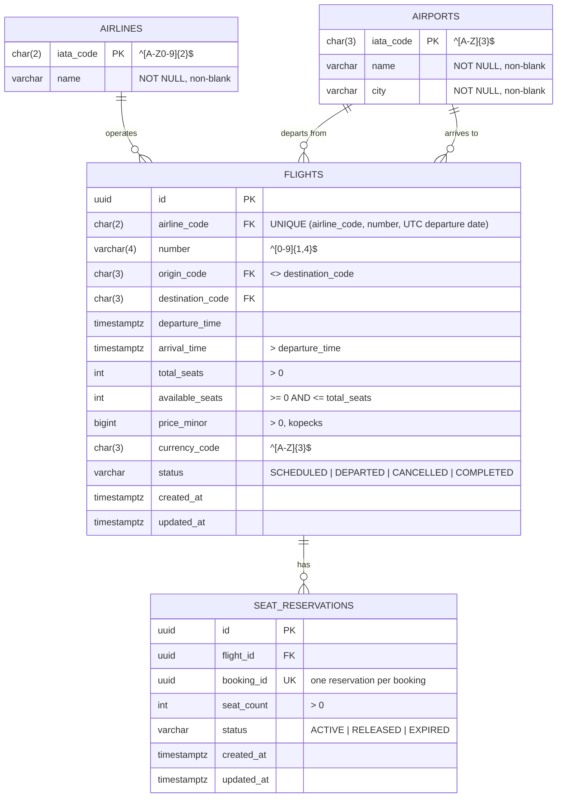
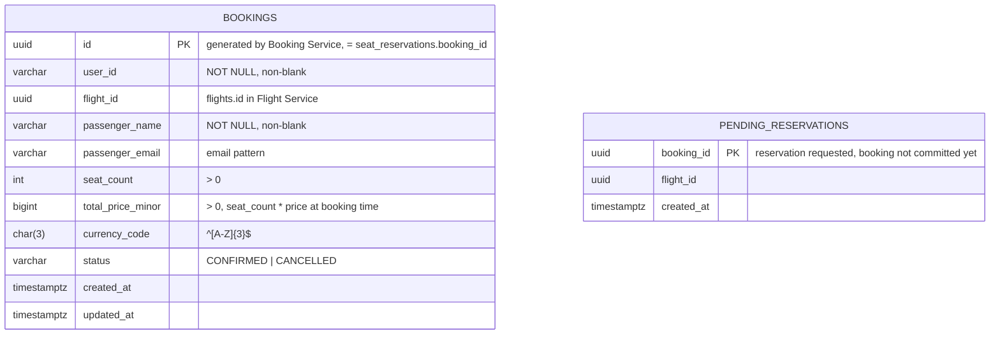

# ER-диаграмма

У каждого сервиса своя база данных. Связи между базами нет на уровне внешних ключей: `bookings.flight_id` и `seat_reservations.booking_id` ссылаются на сущности другого сервиса только по идентификатору.

## Flight Service (БД `flights`)

## Booking Service (БД `bookings`)

## Нормализация (3NF)

- Все атрибуты атомарны (1NF). Номер рейса хранится как пара `airline_code` + `number`, строка `SU1234` собирается при чтении.
- У всех таблиц простой первичный ключ, поэтому частичных зависимостей нет (2NF).
- Транзитивных зависимостей нет (3NF):
  - название авиакомпании зависит от её кода, а название и город аэропорта от IATA-кода, поэтому они вынесены в справочники `airlines` и `airports`;
  - дата вылета не хранится отдельной колонкой, она вычисляется из `departure_time`. Уникальность «номер рейса + дата» обеспечивает уникальный индекс по выражению `(departure_time AT TIME ZONE 'UTC')::date`;
  - `available_seats` не выводится из других колонок `flights`: это счётчик, который меняется в одной транзакции с `seat_reservations`;
  - `total_price_minor` в `bookings` хранит цену на момент бронирования. Цена рейса может измениться позже, поэтому это самостоятельный факт, а цена за место отдельно не хранится, так как она выводится из суммы и количества мест.
