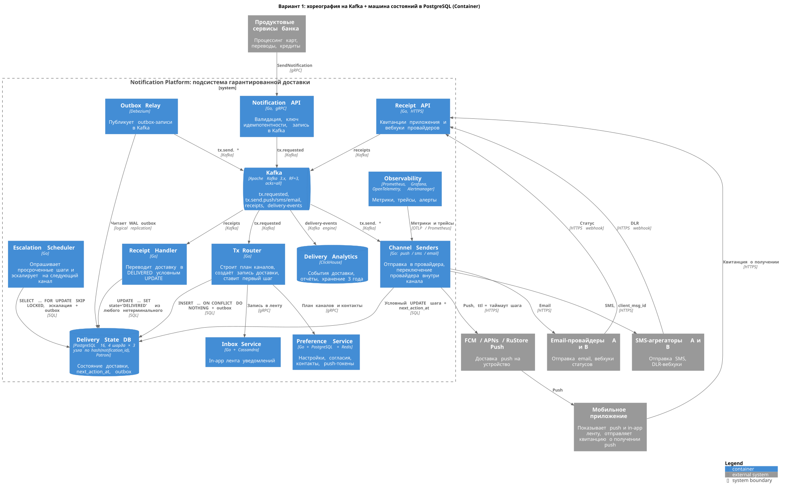
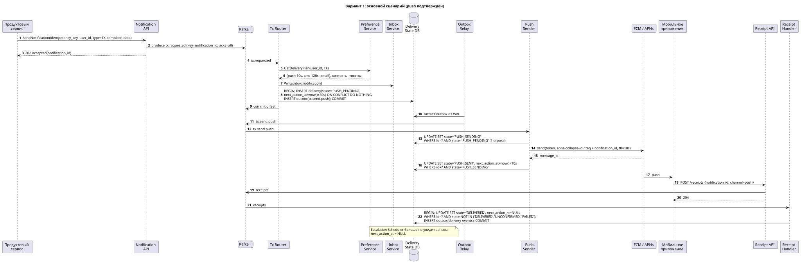
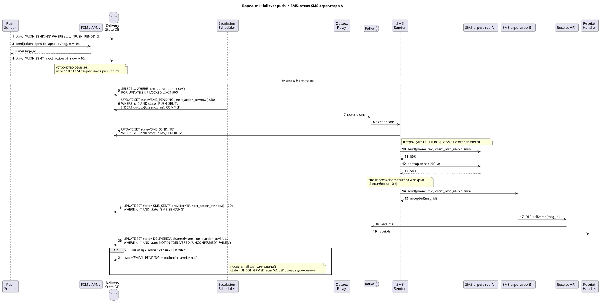
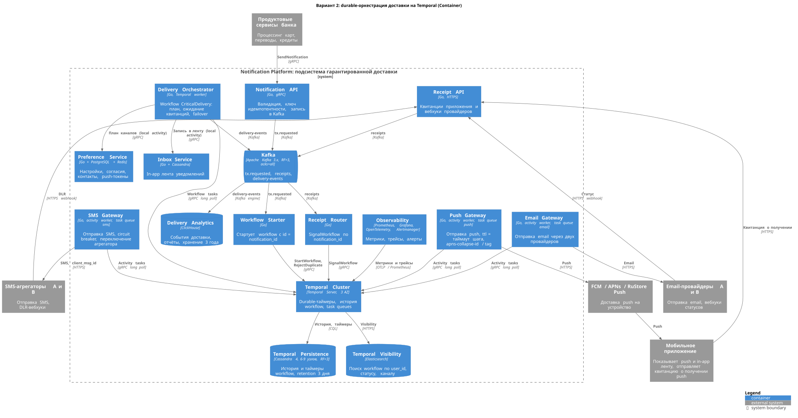
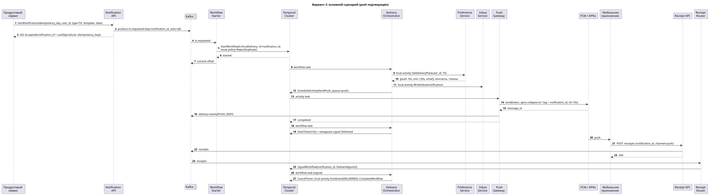
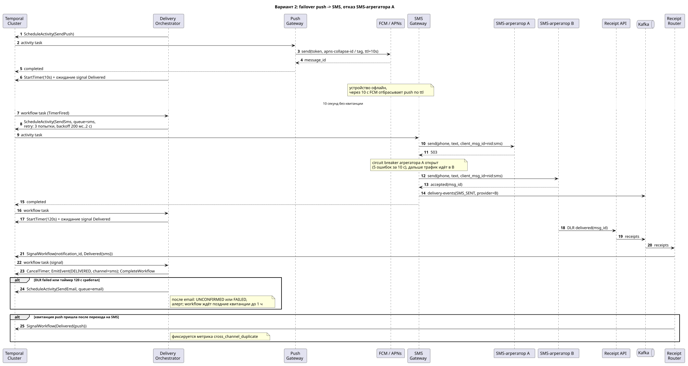

# RFC: Гарантированная доставка критичных уведомлений с кросс-канальным failover

| Метаданные | Значение |
|------------|----------|
| **Статус** | DESIGN |
| **Автор(ы)** | Марк Зильбер |
| **Ответственный** | Марк Зильбер |
| **Бизнес-заказчик** | Владелец продукта Notification Platform |
| **Ревьюеры** | — |
| **Дата создания** | 2026-11-16 |
| **Дата обновления** | 2026-11-17 |

---

## Оглавление

1. [Контекст](#контекст)
2. [Продуктовый анализ](#продуктовый-анализ)
3. [Пользовательские сценарии](#пользовательские-сценарии)
4. [Статистика](#статистика)
5. [Требования](#требования)
6. [Варианты решения](#варианты-решения)
7. [Сравнительный анализ](#сравнительный-анализ)
8. [Выводы](#выводы)
9. [Связанные задачи](#связанные-задачи)
10. [Приложения](#приложения)

---

## Контекст

> **Цель раздела:** Описать проблему или возможность, которую решает данное предложение.

Транзакционные уведомления (списание, зачисление, перевод, вход с нового устройства) сейчас отправляют сами продуктовые команды. У каждой свой канал и своя логика повторов: процессинг карт шлёт SMS всем клиентам, переводы шлют только push и не знают, дошёл ли он. В результате часть списаний клиент не видит вовсе, часть видит дважды, а поддержка не может ответить на вопрос «почему мне не пришло уведомление».

Транзакционное уведомление является частью безопасности: по нему клиент замечает мошенническую операцию. Поэтому в Notification Platform нужна подсистема, которая доводит каждое такое уведомление до клиента хотя бы по одному каналу, переключаясь между push, SMS и email, и при этом не рассылает лишние копии и не превращает каждое уведомление в платное SMS.

RFC детализирует требования и ASR всей платформы из [README.md](README.md) (задания 1–7) применительно к этой подсистеме.

### Ключевые вопросы

- **Какую проблему мы решаем?** Критичные уведомления теряются, дублируются и приходят с задержкой; подтверждения доставки нет, переключения на резервный канал нет, истории доставки нет.
- **Почему это важно сейчас?** Платформа уведомлений создаётся сейчас, и транзакционный путь задаёт её самые жёсткие требования: если не заложить гарантированную доставку в архитектуру сразу, позже её придётся встраивать в работающую систему. Кроме того, текущая схема «SMS всем» у процессинга карт является крупнейшей статьёй расходов на уведомления.
- **Кто затронут?** Клиенты банка (3 млн DAU), продуктовые команды (процессинг карт, переводы, безопасность), поддержка, SRE, мобильная команда (квитанции push), финансовый блок (бюджет SMS).

### Цели

- каждое принятое транзакционное уведомление либо подтверждённо доставлено хотя бы по одному каналу, либо явно помечено как недоставленное с алертом;
- автоматический переход на резервный канал и резервного провайдера;
- учёт настроек клиента: предпочтительный канал, наличие push-токена и email;
- минимальная доля SMS;
- полная история доставки по каждому уведомлению;
- отсутствие дублей при повторах и переключениях.

### Не-цели

- одноразовые коды подтверждения (OTP): у них отдельный поток с другими SLA и требованиями безопасности;
- массовые и сервисные рассылки: они идут через отдельный пайплайн платформы и используют только общий код канальных шлюзов;
- редактор шаблонов и управление кампаниями.

---

## Продуктовый анализ

### Связь с бизнес-целями платформы

| Бизнес-цель | Вклад подсистемы |
|---|---|
| Гарантированная доставка критичных уведомлений | Каскад каналов с подтверждением доставки и алертом на недоставленные |
| −30% жалоб на уведомления | Нет дублей при повторах, нет «не пришло» без следа; поддержка видит историю каждой попытки |
| +15% retention | Клиент доверяет приложению как источнику информации о деньгах; уведомления ведут в приложение (push и in-app лента), а не в SMS |

### Политика уведомлений и каналов

- Транзакционные уведомления отключить нельзя. Клиент выбирает предпочтительный канал: push (по умолчанию, бесплатно) или SMS (платная услуга SMS-информирования).
- Номер телефона у клиента банка есть всегда, поэтому SMS всегда доступно как резерв. Push доступен, если у клиента есть действующий push-токен. Email доступен, если адрес подтверждён.
- План по умолчанию: `push (10 с) → SMS (120 с) → email`. Для клиентов с SMS-информированием: `SMS (120 с) → push (10 с) → email`. Шаги с недоступным каналом пропускаются.
- Каждое уведомление дополнительно записывается в in-app ленту приложения. Лента служит местом, где клиент найдёт сообщение, но квитанцией о доставке не считается.
- Тихие часы и частотные лимиты к транзакционным уведомлениям не применяются.

### Экономика канала SMS

Допущение: 2,5 ₽ за SMS, доля клиентов с подтверждаемым push по расчёту из раздела [Статистика](#статистика).

| Схема | SMS в сутки | Стоимость в месяц |
|---|---|---|
| Всегда SMS (текущая схема процессинга карт) | 6 млн | ≈ 450 млн ₽ |
| push → SMS по таймауту | 1,4 млн | ≈ 106 млн ₽ |

Каскад снижает расходы на SMS в ≈ 4,3 раза, экономия порядка 340 млн ₽ в месяц. Каждый процент клиентов, переведённых с SMS на подтверждаемый push, экономит ≈ 4,5 млн ₽ в месяц.

### Метрики успеха

| Метрика | Цель | Бизнес-цель |
|---|---|---|
| Доля `DELIVERED` за 5 минут | ≥ 99,95% | гарантированная доставка |
| p95 времени до квитанции push | ≤ 5 с | гарантированная доставка |
| Доля SMS среди транзакционных | ≤ 25% | стоимость |
| `cross_channel_duplicate` | ≤ 1% | −30% жалоб |
| Обращения в поддержку по теме «не пришло / пришло дважды» | −30% к текущему уровню | −30% жалоб |

---

## Пользовательские сценарии

> **Цель раздела:** Описать как пользователи будут взаимодействовать с системой.

| Приоритет | Тип сценария | Действующее лицо | Сценарий |
|-----------|--------------|------------------|----------|
| MUST HAVE | Основной | Клиент | Оплатил картой, через несколько секунд получил push о списании. |
| MUST HAVE | Failover канала | Клиент без интернета | Push не подтверждён за 10 с, клиент получил SMS о списании; push после этого не приходит. |
| MUST HAVE | Предпочтение | Клиент с SMS-информированием | Получает уведомление сначала по SMS; push используется только как резерв. |
| MUST HAVE | Failover провайдера | Клиент | SMS-агрегатор A недоступен, SMS приходит через агрегатор B без заметной задержки. |
| MUST HAVE | Идемпотентность | Продуктовый сервис | Повторно отправил запрос с тем же ключом после таймаута; клиент получил одно уведомление. |
| MUST HAVE | Разбор обращения | Сотрудник поддержки | По номеру клиента видит, какие каналы пробовались, когда и с каким результатом. |
| SHOULD HAVE | Резерв | Клиент | Пропустил уведомление и нашёл его в in-app ленте приложения. |
| SHOULD HAVE | Инцидент | Дежурный SRE | Получил алерт, когда доля подтверждённых уведомлений за минуту упала ниже 99%. |
| SHOULD HAVE | Последний канал | Клиент с выключенным телефоном | Получил уведомление на email, когда ни push, ни SMS не подтвердились. |
| COULD HAVE | Оптимизация | Владелец продукта | Таймаут push подстраивается под историю конкретного клиента, доля SMS снижается. |

---

## Статистика

### Исходные данные

MAU 10 млн, DAU 3 млн, Peak Concurrent Users 300 000. На пользователя в день: 2 транзакционных, 3 сервисных, 5 маркетинговых, итого ≈ 10.

### Поток транзакционных уведомлений

| Величина | Расчёт | Результат |
|---|---|---|
| Транзакционных в сутки | 3 млн × 2 | 6 млн |
| Всего уведомлений в сутки | 3 млн × 10 | 30 млн |
| Среднее за сутки | 6 млн / 86 400 с | ≈ 70/с |
| Среднее в активные 16 ч | 6 млн / 57 600 с | ≈ 105/с |
| Пиковый час (коэффициент 3) | 105 × 3 | ≈ 310/с |
| Всплески (зарплата, распродажи, ×2–3 к пиковому часу) | 310 × 2..3 | 600–900/с |
| Проверка через PCU | 300 000 активных, одна операция на клиента за 10 мин сессии: 300 000 / 600 с | ≈ 500/с |
| **Проектная нагрузка** | ≈ 2× от верхней оценки всплеска | **2 000/с** |

### Распределение по каналам

Допущения (проверяются по Н-1 и Н-2 из [README.md](README.md#7-неопределённости-и-архитектурные-риски)): 10% клиентов подключили SMS-информирование; у остальных 90% основной канал push, из них 85% подтверждаются за 10 с.

| Величина | Расчёт | Результат |
|---|---|---|
| Доставлено push | 0,90 × 0,85 | 76,5% (≈ 4,6 млн/сутки) |
| Ушло в SMS | 0,10 + 0,90 × 0,15 | 23,5% (≈ 1,4 млн/сутки) |
| SMS в пике | 2 000 × 0,235 | ≈ 470/с |
| Ушло в email | ≈ 3% от SMS без DLR | ≈ 40 тыс./сутки |
| Квитанций push от приложений | 0,9 × 6 млн транзакционных + ≈ 20 млн push других типов | ≈ 300/с в среднем, до 5 000/с в пике кампаний |

Вывод для провайдеров: каждый из двух SMS-агрегаторов должен держать ≥ 500 TPS выделенной квоты под транзакционный трафик, чтобы один агрегатор мог принять весь поток при отказе второго.

---

## Требования

### Функциональные требования

> **Определение:** Функциональные требования определяют, каким должно быть поведение продукта в тех или иных условиях.

Детализируют FR-1, FR-2, FR-3, FR-4, FR-7, FR-8 платформы из [README.md](README.md#1-функциональные-требования).

| № | Приоритет | Обозначение | Требование |
|---|-----------|-------------|------------|
| 1 | MUST HAVE | D-FR1 | Подсистема принимает транзакционное уведомление и возвращает `notification_id`. Повторный запрос с тем же ключом идемпотентности возвращает тот же `notification_id` и не порождает повторной отправки. |
| 2 | MUST HAVE | D-FR2 | Подсистема строит план каналов по настройкам клиента и доступности каналов. Транзакционные уведомления клиент отключить не может. |
| 3 | MUST HAVE | D-FR3 | Подсистема отправляет уведомление по первому шагу плана и ждёт квитанцию. При отказе канала или истечении таймаута она переходит к следующему шагу. Получение квитанции завершает доставку. |
| 4 | MUST HAVE | D-FR4 | Внутри канала подсистема переключается на резервного провайдера, если основной недоступен. |
| 5 | MUST HAVE | D-FR5 | Каждая попытка (канал, провайдер, время, результат) и итоговый статус сохраняются; поддержка находит их по `notification_id` или `user_id`. |
| 6 | SHOULD HAVE | D-FR6 | Уведомление сохраняется в in-app ленте независимо от результата доставки. |
| 7 | SHOULD HAVE | D-FR7 | Статусы `UNCONFIRMED` и `FAILED` попадают в метрики и вызывают алерт при превышении порога. |
| 8 | SHOULD HAVE | D-FR8 | Квитанция, пришедшая после перехода на следующий канал или после завершения доставки, сохраняется в истории и не меняет уже принятых решений. |
| 9 | COULD HAVE | D-FR9 | Таймаут ожидания push вычисляется по истории квитанций конкретного клиента. |

### Нефункциональные требования

> **Определение:** Нефункциональные требования определяют не что система делает, а как хорошо она это делает.

Детализируют NFR-1, NFR-2, NFR-3, NFR-5, NFR-6, NFR-7, NFR-9, NFR-10 платформы из [README.md](README.md#2-нефункциональные-требования).

| № | Приоритет | Обозначение | Требование |
|---|-----------|-------------|------------|
| 1 | MUST HAVE | D-NFR1 | Latency: от приёма до передачи первому провайдеру p95 ≤ 1 с, p99 ≤ 2 с. Подтверждённая доставка push p95 ≤ 5 с. SMS передаётся провайдеру ≤ 15 с от приёма, если push не подтверждён. |
| 2 | MUST HAVE | D-NFR2 | Durability: RPO = 0 для принятых уведомлений при отказе узла или одной зоны доступности. |
| 3 | MUST HAVE | D-NFR3 | Reliability: ≥ 99,95% уведомлений получают статус `DELIVERED` за 5 минут (среди клиентов хотя бы с одним достижимым каналом). |
| 4 | MUST HAVE | D-NFR4 | Availability: API приёма 99,99% в месяц (≤ 4,3 мин простоя). |
| 5 | MUST HAVE | D-NFR5 | Fault tolerance: отказ SMS- или email-провайдера обнаруживается и трафик уходит к резервному за ≤ 30 с без участия человека. У push резервного провайдера нет (FCM, APNs и RuStore Push обслуживают разные устройства), поэтому для push failover только межканальный. |
| 6 | MUST HAVE | D-NFR6 | Scalability: 2 000 уведомлений/с на входе без деградации задержки; рост добавлением экземпляров. |
| 7 | MUST HAVE | D-NFR7 | Isolation: во время массовой кампании p95 задержки транзакционных растёт не больше чем на 10%. |
| 8 | SHOULD HAVE | D-NFR8 | Duplicates: повторов в одном канале ≤ 0,01%; доставок и push, и SMS ≤ 1%. |
| 9 | SHOULD HAVE | D-NFR9 | Наблюдаемость: логирование, метрики, трейсинг. Статус уведомления виден поддержке ≤ 10 с после события; алерт по падению доли `DELIVERED` за 1 мин ниже 99% срабатывает ≤ 2 мин; история хранится 3 года. |
| 10 | SHOULD HAVE | D-NFR10 | Cost: доля SMS среди транзакционных ≤ 25%. |

### Архитектурно значимые требования (ASR)

Приоритеты: P1 нельзя нарушить ни при каких компромиссах, P2 важно для бизнес-целей, P3 оптимизируется в рамках P1–P2.

| ASR | Из README | Приоритет | Связанные требования | Почему влияет на архитектуру |
|---|---|---|---|---|
| D-ASR1. Гарантированная доставка | ASR-1 | P1 | D-FR3, D-FR4, D-NFR2, D-NFR3, D-NFR5 | Доставка становится долгим процессом с состоянием и таймерами, который должен переживать падение любого процесса; нужен источник квитанций от каждого канала. |
| D-ASR2. Низкая задержка | ASR-2 | P1 | D-NFR1, D-NFR6 | Минимум синхронных шагов до первой отправки; настройки и контакты читаются из кэша. |
| D-ASR3. Изоляция от массовых кампаний | ASR-2, ASR-3 | P2 | D-NFR6, D-NFR7 | Кампания на 1 млн сообщений не должна делить с транзакционным трафиком очереди, обработчики, хранилище состояния и квоты провайдеров. |
| D-ASR4. Отсутствие дублей | ASR-4 | P2 | D-FR1, D-FR8, D-NFR8 | Нужен единственный владелец решения о переключении на уведомление и идемпотентность на каждом шаге. |
| D-ASR5. Наблюдаемость | ASR-5 | P3 | D-FR5, D-FR7, D-NFR9 | История по каждому уведомлению, события статусов, SLO-алерты, отдельное аналитическое хранилище. |
| D-ASR6. Стоимость | ASR-6 | P3 | D-FR9, D-NFR10 | Push первым, SMS только по таймауту; таймаут настраивается по данным, для этого нужны квитанции push. |

**Расчёт нагрузок:**
```
Вход (проектный пик)        2 000 уведомлений/с  (среднее ≈ 70/с, всплески 600–900/с)

Kafka
  tx.requested              2 000/с × 2 КБ    ≈ 4 МБ/с
  receipts                  5 000/с × 0,3 КБ  ≈ 1,5 МБ/с
  delivery-events           8 000/с × 0,5 КБ  ≈ 4 МБ/с
  итого                     ≈ 10 МБ/с на запись, RF = 3
  → 6 брокеров (по 2 на зону) ради отказоустойчивости, запас по пропускной способности больше порядка
  → tx.requested: 128 партиций, ключ notification_id; Starter/Router обрабатывают сообщения партиции параллельно

SMS-провайдеры
  2 000/с × 23,5%           ≈ 470 SMS/с → ≥ 500 TPS у каждого из двух агрегаторов

Receipt API
  до 5 000 RPS в пике кампаний, stateless, ≈ 6 подов по 1 000 RPS

ClickHouse (история доставки)
  события: 6 млн × 5 (транзакционные) + 24 млн × 3 (остальные) ≈ 100 млн строк/сутки
  100 млн × 200 Б ≈ 20 ГБ/сутки до сжатия, ≈ 2–2,5 ГБ/сутки после сжатия ×8–10
  3 года для транзакционных, 1 год для остальных → ≈ 1,5–2 ТБ на реплику

Хранилище состояния доставки: см. «Нагрузка на хранилище» в каждом варианте
```

---

## Варианты решения

### Общие элементы обоих вариантов

Эти механизмы одинаковы в обоих вариантах; варианты различаются тем, где живёт состояние доставки и кто принимает решение о переключении.

**Приём.** Notification API проверяет запрос, вычисляет `notification_id = UUIDv5(producer_id, idempotency_key)` и пишет его в Kafka `tx.requested` с `acks=all`, `min.insync.replicas=2`. Ответ 202 отдаётся только после подтверждения записи. Продуктовые сервисы отправляют запросы из своего transactional outbox и повторяют их до получения 202.

**План каналов.** Preference Service (PostgreSQL + Redis-кэш) возвращает план, контакты и push-токены. При недоступности Preference Service используется последний снимок из Redis.

**Канальные шлюзы.** Отдельные пулы обработчиков для push, SMS и email. С массовым пайплайном у них общий только код: экземпляры, очереди и квоты у провайдеров у транзакционного трафика свои.
- Push: FCM, APNs, RuStore Push. `ttl` push равен таймауту шага, поэтому push, не доставленный за 10 с, сервис push-уведомлений отбрасывает, и он не придёт клиенту после SMS. `apns-collapse-id` (iOS) и `tag` уведомления (Android), равные `notification_id`, склеивают повторы на устройстве.
- SMS: агрегаторы A и B, `client_msg_id = notification_id:sms`. Circuit breaker на каждого: 5 ошибок за 10 с открывают его на 30 с, трафик уходит ко второму агрегатору.
- Email: два провайдера, заголовок `Message-ID` из `notification_id`.

**Квитанции.** Receipt API (stateless HTTPS) принимает квитанции приложения и вебхуки провайдеров, проверяет подпись и пишет их в Kafka `receipts`.

**Дедупликация на трёх уровнях.**
1. Повтор от продукта: одинаковый `notification_id` отбрасывается хранилищем состояния.
2. Повтор в одном канале: `client_msg_id` у SMS, `apns-collapse-id` / `tag` у push, `Message-ID` у email.
3. Пересечение каналов: `ttl` push равен таймауту шага; решение о переключении принимает один владелец, который атомарно сравнивает его с приходом квитанции.

**Наблюдаемость.** Все компоненты пишут события статусов в Kafka `delivery-events`, оттуда они попадают в ClickHouse через Kafka engine. Prometheus + Grafana для метрик, OpenTelemetry для трейсов с атрибутом `notification_id`, структурные логи в Loki, Alertmanager для SLO-алертов. Ключевые метрики: доля `DELIVERED` за 1 и 5 минут, время до квитанции по каналам, доля failover, доля SMS, `cross_channel_duplicate`, ошибки провайдеров.

---

### Вариант 1: Хореография на Kafka и машина состояний в PostgreSQL

> **Описание:** Состояние каждого уведомления хранится строкой в шардированном PostgreSQL. Несколько stateless-сервисов двигают его по шагам условными `UPDATE`, команды на отправку передаются через transactional outbox и Kafka, таймеры реализованы опросом колонки `next_action_at`.

#### Архитектура

Каждый сервис меняет состояние условным `UPDATE ... WHERE state = <ожидаемое>`, поэтому из двух конкурирующих переходов выполняется только один. Изменение состояния и запись в outbox делаются в одной транзакции, Debezium переносит outbox в Kafka.

- **Tx Router** читает `tx.requested`, получает план, создаёт строку (`INSERT ... ON CONFLICT DO NOTHING` по `notification_id`) сразу с `next_action_at = now() + 30 с`, пишет в ленту и ставит первый шаг в outbox. Страховочный таймер гарантирует, что строка, застрявшая в `PUSH_PENDING` (упал Sender, провайдер отверг сообщение), будет эскалирована Scheduler'ом.
- **Channel Senders** читают `tx.send.push|sms|email` и перед вызовом провайдера забирают шаг: `UPDATE SET state='*_SENDING' WHERE state='*_PENDING'`. Если обновлено 0 строк (уведомление уже доставлено или эскалировано), сообщение не отправляется. После ответа провайдера Sender переводит шаг в `*_SENT` условием `WHERE state='*_SENDING'` и ставит `next_action_at = now() + таймаут`.
- **Escalation Scheduler** раз в 200 мс на каждом шарде выбирает строки с `next_action_at <= now()` через `FOR UPDATE SKIP LOCKED` и переводит их на следующий шаг. Строку в `*_SENDING` с истёкшим таймером (Sender упал после захвата шага) он один раз возвращает в `*_PENDING` и повторяет шаг; возможную повторную отправку гасят `client_msg_id` и `apns-collapse-id` / `tag`. При повторном зависании Scheduler переходит к следующему каналу.
- **Receipt Handler** читает `receipts` и переводит строку в `DELIVERED` из любого нетерминального состояния (`WHERE state NOT IN ('DELIVERED','UNCONFIRMED','FAILED')`), обнуляя `next_action_at`. Квитанция любого канала означает доставку, поэтому, например, поздняя квитанция push в состоянии `SMS_PENDING` отменяет ещё не ушедшее SMS.
- **Delivery State DB**: PostgreSQL 16, 4 шарда по `hash(notification_id)`, на каждом шарде Patroni из 3 узлов в трёх зонах (лидер, синхронная и асинхронная реплика). При потере синхронной реплики её роль берёт асинхронная, и RPO = 0 сохраняется. Частичный индекс по `next_action_at WHERE next_action_at IS NOT NULL`. Строки старше 7 дней удаляет фоновая задача, долгосрочная история хранится в ClickHouse.

**C4 Container**



Исходник: [docs/c4-variant-a.puml](docs/c4-variant-a.puml).

**Основной сценарий: push подтверждён**



Исходник: [docs/seq-a-main.puml](docs/seq-a-main.puml).

**Сценарий failover: push не подтверждён, SMS-агрегатор A недоступен**

Push не подтверждён за 10 с, Escalation Scheduler переводит уведомление на SMS. Агрегатор A отвечает ошибками, circuit breaker открывается, SMS уходит через агрегатор B, DLR от B завершает доставку.



Исходник: [docs/seq-a-failover.puml](docs/seq-a-failover.puml).

**Нагрузка на хранилище**

```
Транзакций на уведомление: основной сценарий 4, failover ≈ 7, в среднем 0,765 × 4 + 0,235 × 7 ≈ 5
2 000/с × 5                         = 10 000 коммитов/с ≈ 2 500 на шард
Строк с активным таймером в пике:   2 000/с × 10 с + 470/с × 120 с ≈ 76 тыс.
Объём: 1 КБ × 6 млн                 = 6 ГБ/сутки, 7 дней ≈ 45 ГБ на кластер
```

Для PostgreSQL на NVMe с синхронной репликой 2 500 коммитов/с на шард являются рабочим режимом с запасом, частичный индекс таймеров помещается в память.

**Как вариант выполняет ASR**

| ASR | Как выполняется |
|---|---|
| D-ASR1 | Kafka с `acks=all` и синхронная реплика PostgreSQL дают RPO = 0. Таймеры хранятся в БД как `next_action_at` и переживают падение любого процесса. Scheduler на каждом шарде запущен в двух экземплярах, `SKIP LOCKED` исключает двойную обработку. |
| D-ASR2 | До первой отправки: запись в Kafka, чтение Router, вызов Preference Service, коммит в БД, передача через Debezium (≈ 100–300 мс), отправка провайдеру. p95 ≈ 0,4–0,6 с. Опрос таймеров добавляет до 200 мс к моменту эскалации. |
| D-ASR3 | Массовые рассылки идут через отдельные топики и отдельные экземпляры Channel Senders со своими квотами у провайдеров; кампания не попадает ни в `tx.*`, ни в Delivery State DB. |
| D-ASR4 | Уникальный ключ `notification_id`; условные `UPDATE` делают переход «эскалировать» и переход «доставлено» взаимоисключающими. Корректность держится на том, что все четыре сервиса правильно задают условия переходов. |
| D-ASR5 | События статусов в ClickHouse, метрики и трейсы. Экран истории для поддержки и поиск по `user_id` разрабатываются отдельно поверх ClickHouse и Delivery State DB. |
| D-ASR6 | Каскад push → SMS; таймаут хранится в плане и может отличаться для клиента. |

**Технологии:** Go, Apache Kafka 3.x, PostgreSQL 16 + Patroni, Debezium, Redis, Cassandra (in-app лента), ClickHouse, Prometheus, Grafana, Loki, OpenTelemetry, Kubernetes в трёх зонах доступности.

#### Этапы реализации

| Этап | Описание | Планируемый срок | Ресурсы | Риски |
|------|----------|------------------|---------|-------|
| 1 | Схема Delivery State DB, шардирование, outbox и Debezium | 3 недели | 2 backend, 1 DBA | Нагрузка опроса таймеров выше расчётной |
| 2 | Tx Router, Channel Senders, Escalation Scheduler, Receipt Handler, машина состояний | 5 недель | 3 backend | Ошибки в условиях переходов, проявляющиеся только под конкурентной нагрузкой |
| 3 | Квитанции push в мобильном приложении (параллельно с этапами 1–2) | 3 недели | 1 iOS, 1 Android | Медленное обновление приложения клиентами |
| 4 | Экран истории доставки для поддержки поверх ClickHouse (параллельно с этапом 2) | 3 недели | 1 backend, 1 frontend | Расхождение данных ClickHouse и Delivery State DB |
| 5 | Теневой режим на уведомлениях процессинга карт, сравнение с текущей отправкой | 2 недели | 1 backend, 1 SRE | Найденные расхождения требуют доработки машины состояний |
| 6 | Перевод транзакционных уведомлений всех команд, отключение старой отправки | 4 недели | 2 backend, команды-продюсеры | Команды-продюсеры не успевают перейти на transactional outbox |

Итого ≈ 14 недель с учётом параллельных этапов 3 и 4.

#### Преимущества

- только технологии, которые в банке уже эксплуатируются;
- простая модель масштабирования (stateless-сервисы + шардированная БД);
- инфраструктура дешевле варианта 2.

#### Недостатки

- логика доставки распределена между Router, Senders, Scheduler и Receipt Handler; новый шаг или новое правило (например, адаптивный таймаут) меняет несколько сервисов и набор состояний;
- корректность машины состояний обеспечивается вручную написанными условиями переходов во многих местах;
- повторы и backoff внутри шага, ожидание поздних квитанций, история по уведомлению реализуются самостоятельно;
- опрос `next_action_at` нагружает каждый шард постоянно, даже без трафика.

---

### Вариант 2: Durable-оркестрация на Temporal

> **Описание:** Каждое транзакционное уведомление обрабатывается отдельным Temporal workflow `CriticalDelivery` с `workflow_id = notification_id`. Workflow выполняет план каналов шаг за шагом: вызывает activity отправки, ставит durable-таймер и ждёт signal с квитанцией.

#### Архитектура

Таймер и signal обрабатываются в одном потоке выполнения workflow строго по очереди, поэтому гонка «таймер сработал одновременно с квитанцией» исключена движком.

```text
plan := GetDeliveryPlan(user, TX)              // local activity
WriteInbox(notification)                        // local activity
for step in plan:
    res := SendVia(step.channel)                // activity в task queue канала
    if res == PERMANENT_FAILURE: continue
    select { signal Delivered -> emit DELIVERED; return
             timer(step.timeout) -> continue }
emit UNCONFIRMED или FAILED; alert
wait late receipts up to 1h                     // только для UNCONFIRMED
```

- **Notification API** и **Kafka** описаны в общих элементах. Kafka стоит перед Temporal как буфер: при недоступности Temporal уведомления накапливаются в `tx.requested` и не теряются.
- **Workflow Starter** читает `tx.requested` и вызывает `StartWorkflow` с политикой `RejectDuplicate`; offset коммитится после ответа Temporal. Повторное чтение того же сообщения получает отказ «уже запущен» и просто коммитит offset. Окно дедупликации равно retention закрытых workflow (3 дня); продукты повторяют запросы в пределах минут, поэтому этого достаточно.
- **Temporal Cluster**: frontend, history и matching сервисы в трёх зонах, 2 048 history shards. Persistence: Cassandra 4, 6–9 узлов (по результатам PoC), RF = 3, `LOCAL_QUORUM`. Visibility: Elasticsearch с атрибутами поиска `user_id`, `channel`, `status`. Retention закрытых workflow 3 дня, долгосрочная история в ClickHouse.
- **Delivery Orchestrator**: Temporal worker с кодом workflow. План и запись в ленту выполняются local activity, чтобы не проходить через task queue и matching.
- **Push / SMS / Email Gateway**: activity workers на отдельных task queue `push`, `sms`, `email`. Повторы activity: 3 попытки с backoff от 200 мс до 2 с; переключение провайдера внутри канала делает сам шлюз по circuit breaker.
- **Receipt Router** читает `receipts` и вызывает `SignalWorkflow(notification_id)`. Если workflow уже закрыт, квитанция только пишется в `delivery-events`.

**C4 Container**



Исходник: [docs/c4-variant-b.puml](docs/c4-variant-b.puml).

**Основной сценарий: push подтверждён**



Исходник: [docs/seq-b-main.puml](docs/seq-b-main.puml).

**Сценарий failover: push не подтверждён, SMS-агрегатор A недоступен**



Исходник: [docs/seq-b-failover.puml](docs/seq-b-failover.puml).

**Нагрузка на Temporal**

```
История workflow: основной сценарий ≈ 15 событий, failover ≈ 25
Записей в Cassandra на workflow (пачка на workflow task): 6 основной, 10 failover, в среднем ≈ 7
2 000/с × 7                         ≈ 14 000 записей/с
с RF = 3                            ≈ 42 000 записей реплик/с ≈ 7 000 на узел из 6
Размер истории ≈ 10 КБ:  6 млн × 10 КБ = 60 ГБ/сутки, × RF 3 × retention 3 дня ≈ 0,6 ТБ
Открытых workflow с ожиданием поздних квитанций: 2 000 × 1% × 3 600 с ≈ 72 тыс.
Накладные расходы до первой отправки: 3–4 обращения к history service × 5–20 мс = +30–100 мс
```

Temporal обновляет состояние workflow в Cassandra условными записями (LWT), каждая из которых требует нескольких раундов Paxos и в разы дороже обычной записи. С учётом LWT-записей Temporal 6 узлов следует считать нижней границей, итоговый размер кластера (6–9 узлов) фиксируется по результатам PoC (Н-5 в [README.md](README.md#7-неопределённости-и-архитектурные-риски)).

**Как вариант выполняет ASR**

| ASR | Как выполняется |
|---|---|
| D-ASR1 | Приём через Kafka (`acks=all`) даёт RPO = 0 до старта workflow; дальше состояние и таймеры хранятся в Cassandra с RF = 3 и кворумной записью. Падение worker'а приводит к повторной выдаче task другому worker'у. Таймауты, повторы activity и ожидание поздних квитанций реализует движок. |
| D-ASR2 | До первой отправки: Kafka, старт workflow, workflow task, activity task, вызов провайдера. p95 ≈ 0,3–0,5 с. |
| D-ASR3 | Массовые рассылки идут через отдельный Kafka-пайплайн и отдельные экземпляры шлюзов со своими квотами у провайдеров. Через Temporal проходят только транзакционные уведомления, поэтому кампания на 1 млн сообщений не нагружает Temporal и Cassandra. Отдельные task queue на канал не дают медленному каналу задерживать остальные. |
| D-ASR4 | `workflow_id = notification_id` с `RejectDuplicate` отсекает повторы от продуктов. Решение о переходе к следующему каналу принимает только код workflow, который обрабатывает таймер и signal последовательно. Повторы activity дедуплицируются `client_msg_id`, `apns-collapse-id` / `tag` и `Message-ID`. |
| D-ASR5 | Экран истории доставки для поддержки строится поверх ClickHouse, как в варианте 1: Temporal хранит закрытые workflow только 3 дня. Temporal UI с полной пошаговой историей workflow используют разработчики и SRE для разбора свежих инцидентов; входные данные workflow шифруются codec'ом, поэтому PII в UI не видны. Метрики Temporal (`schedule_to_start_latency`, размер очередей) показывают затор раньше, чем падает доля доставки. |
| D-ASR6 | Каскад push → SMS. План, таймауты и порядок каналов задаются в одном месте, адаптивный таймаут (D-FR9) добавляется изменением кода workflow. |

**Технологии:** Go, Temporal Server (self-hosted), шифрующий Data Converter (Payload Codec, AES-GCM, ключи в Vault) для входных данных workflow, Cassandra 4, Elasticsearch, Apache Kafka 3.x, PostgreSQL 16 + Redis (настройки), Cassandra (in-app лента), ClickHouse, Prometheus, Grafana, Loki, OpenTelemetry, Kubernetes в трёх зонах доступности.

#### Этапы реализации

| Этап | Описание | Планируемый срок | Ресурсы | Риски |
|------|----------|------------------|---------|-------|
| 1 | PoC Temporal и нагрузочный тест на профиле из раздела «Статистика» | 2 недели | 2 backend, 1 SRE | Temporal не выдерживает 2 000 workflow/с с p95 ≤ 1 с; тогда переход к варианту 1 |
| 2 | Промышленное развёртывание Temporal, Cassandra, Elasticsearch в трёх зонах; runbook и учения по отказу зоны | 3 недели | 2 SRE | У команды нет опыта эксплуатации Temporal |
| 3 | Workflow `CriticalDelivery`, канальные шлюзы, Workflow Starter, Receipt Router, шифрующий Data Converter | 4 недели | 3 backend | Ошибки версионирования workflow при последующих изменениях |
| 4 | Экран истории доставки для поддержки поверх ClickHouse (параллельно с этапом 3) | 3 недели | 1 backend, 1 frontend | Расхождение данных ClickHouse и Temporal |
| 5 | Квитанции push в мобильном приложении (параллельно с этапами 1–3) | 3 недели | 1 iOS, 1 Android | Медленное обновление приложения клиентами |
| 6 | Теневой режим на уведомлениях процессинга карт, сравнение с текущей отправкой | 2 недели | 1 backend, 1 SRE | Найденные расхождения в плане каналов |
| 7 | Перевод транзакционных уведомлений всех команд, отключение старой отправки | 4 недели | 2 backend, команды-продюсеры | Команды-продюсеры не успевают перейти на transactional outbox |

Итого ≈ 15 недель с учётом параллельных этапов 4 и 5.

#### Преимущества

- вся логика доставки в одном workflow, читается как последовательный код;
- отсутствие гонки между таймером и квитанцией обеспечено моделью исполнения;
- durable-таймеры произвольной длины, повторы с backoff, поздние квитанции из коробки;
- пошаговая история каждого workflow для разбора инцидентов разработчиками и SRE.

#### Недостатки

- новый для команды компонент с собственной эксплуатацией: Temporal, Cassandra, Elasticsearch;
- Temporal становится зависимостью критического пути;
- payload workflow нужно шифровать отдельным codec'ом, иначе PII хранятся в истории Temporal открыто;
- изменения кода workflow требуют версионирования (`workflow.GetVersion`), иначе ломаются уже запущенные экземпляры;
- число history shards задаётся при создании кластера и потом не меняется.

---

## Сравнительный анализ

### Ресурсные требования

| Критерий | Вариант 1 | Вариант 2 |
|----------|-----------|-----------|
| Время реализации | ≈ 14 недель | ≈ 15 недель |
| Команда | 3 backend, 1 DBA, 1 frontend, 1 iOS, 1 Android, 1 SRE | 3 backend, 2 SRE, 1 frontend, 1 iOS, 1 Android |
| Инфраструктура | 4 шарда PostgreSQL × 3 узла (лидер, синхронная и асинхронная реплика), Debezium; Kafka, ClickHouse, Redis общие | Temporal ≈ 9 подов, Cassandra 6–9 узлов (по PoC), Elasticsearch 3 узла; Kafka, ClickHouse, Redis общие |
| Организационные риски | Сложная машина состояний в 4 сервисах, знание о ней сосредоточено у авторов | Новая для банка платформа, нужно обучение SRE и согласование с ИБ |

### Соответствие требованиям

| Требование | Вариант 1 | Вариант 2 |
|------------|-----------|-----------|
| D-FR1 | ✅ Да | ✅ Да |
| D-FR2 | ✅ Да | ✅ Да |
| D-FR3 | ✅ Да | ✅ Да |
| D-FR4 | ✅ Да | ✅ Да |
| D-FR5 | ✅ Да, экран истории поверх ClickHouse | ✅ Да, экран истории поверх ClickHouse |
| D-FR6 | ✅ Да | ✅ Да |
| D-FR7 | ✅ Да | ✅ Да |
| D-FR8 | ✅ Да | ✅ Да |
| D-FR9 | ✅ Да, изменения в Router и Scheduler | ✅ Да, изменение одного workflow |
| D-NFR1 | ✅ Да, p95 ≈ 0,4–0,6 с | ✅ Да, p95 ≈ 0,3–0,5 с |
| D-NFR2 | ✅ Да | ✅ Да |
| D-NFR3 | ✅ Да | ✅ Да |
| D-NFR4 | ✅ Да | ✅ Да |
| D-NFR5 | ✅ Да | ✅ Да |
| D-NFR6 | ✅ Да | ✅ Да, подтверждается PoC |
| D-NFR7 | ✅ Да | ✅ Да |
| D-NFR8 | ✅ Да, при корректных условиях переходов | ✅ Да, гарантируется моделью исполнения |
| D-NFR9 | ✅ Да | ✅ Да |
| D-NFR10 | ✅ Да | ✅ Да |

### Сравнение по ASR

| ASR | Вариант 1 | Вариант 2 |
|---|---|---|
| D-ASR1: надёжность состояния и таймеров | Обеспечивается, таймеры через опрос БД | Обеспечивается движком |
| D-ASR2: задержка до первой отправки, p95 | ≈ 0,4–0,6 с | ≈ 0,3–0,5 с |
| D-ASR3: изоляция от кампаний | Отдельные топики и экземпляры | Отдельные топики и экземпляры, кампании не проходят через Temporal |
| D-ASR4: защита от гонки таймер/квитанция | Условия переходов в 4 сервисах | Последовательная обработка в workflow |
| D-ASR5: история по уведомлению | Экран поддержки поверх ClickHouse | Экран поддержки поверх ClickHouse; для свежих инцидентов дополнительно история workflow в Temporal |
| D-ASR6: гибкость политики каналов | Новое состояние меняет несколько сервисов | Меняется код одного workflow |
| Поведение при отказе ядра | Отказ шарда PostgreSQL: Patroni переключает за ≈ 30 с | Отказ Temporal: уведомления копятся в Kafka и уходят после восстановления |

Оба варианта формально закрывают все требования. Разница в том, чем обеспечено D-ASR4: в варианте 1 правильностью кода четырёх сервисов, в варианте 2 моделью исполнения движка.

---

## Выводы

> **Рекомендация:** Вариант 2, durable-оркестрация на Temporal.

**Обоснование выбора:**

1. Самое сложное требование подсистемы (D-ASR1 вместе с D-ASR4) сводится к долгому процессу с таймерами и внешними событиями, который должен быть корректен при повторах и падениях. Temporal решает именно эту задачу, а вариант 1 реализует её же вручную, распределив по четырём сервисам. Ошибка в любом условии перехода варианта 1 даёт либо дубль SMS, либо потерянное уведомление, и такие ошибки проявляются только под конкурентной нагрузкой.
2. Политика каналов будет меняться: адаптивный таймаут push (D-FR9), новые push-сервисы, отдельные правила для операций выше порога суммы. В варианте 2 каждое такое изменение затрагивает один workflow.
3. Нагрузка подсистемы умеренная: 2 000 workflow/с в проектном пике и ≈ 70/с в среднем. По оценке она укладывается в кластер Temporal с 6–9 узлами Cassandra (подтверждается PoC), а массовые рассылки, дающие основной объём, через Temporal не идут.

Цена решения: эксплуатация Temporal и Cassandra и примерно на неделю более долгий запуск. Она оправдана, потому что подсистема критичная, а ошибки доставки напрямую стоят денег (лишние SMS) и доверия клиентов. Если PoC на этапе 1 покажет, что Temporal не выдерживает нагрузку, реализуется вариант 1.

### Компромиссы и ограничения

- **Определение гарантии.** Платформа гарантирует, что принятое уведомление не будет потеряно и будет доведено до одного из конечных статусов. Физическую доставку на выключенный телефон без email гарантировать нельзя; такие случаи получают статус `UNCONFIRMED`, уведомление остаётся в in-app ленте, а SMS-центр оператора продолжает попытки в пределах срока жизни SMS.
- **Двойная доставка push + SMS возможна.** Если push дошёл на 9-й секунде, а квитанция задержалась в сети, клиент получит и SMS. Это сознательный выбор в пользу гарантии; окно сужают `ttl` push и подбор таймаута, а размер эффекта видно по метрике `cross_channel_duplicate` (цель ≤ 1%).
- **Таймаут SMS-провайдера неоднозначен.** Если агрегатор A принял SMS, но ответ потерялся, переключение на B даст две SMS. Шлюз сначала запрашивает статус по `client_msg_id` у A и только потом уходит к B; если A не поддерживает такой запрос, остаётся риск повтора, ограниченный случаями таймаутов.
- **Квитанции push зависят от версии приложения.** Старые версии не отправляют квитанцию, для их владельцев каждое уведомление уйдёт в SMS после таймаута. Пока доля таких версий заметна, доля SMS будет выше расчётной.
- **Отказ Temporal ухудшает задержку.** Уведомления сохраняются в Kafka и уходят после восстановления, поэтому они не теряются, но D-NFR1 на время отказа нарушается. Снижается развёртыванием в трёх зонах и алертом на рост lag `tx.requested`.
- **Массовая эскалация при сбое пути квитанций.** Если недоступны Receipt API или FCM/APNs либо лаг консьюмера `receipts` больше таймаута push, все уведомления уйдут в SMS (до 2 000/с при квоте 2 × 500 TPS). Перед эскалацией проверяются лаг `receipts` и доля квитанций push по системе за последнюю минуту: в варианте 1 проверку делает Escalation Scheduler, в варианте 2 workflow вызывает local activity `CheckEscalationGuard` перед шагом SMS. При аномалии таймер push продлевается, но не больше чем до 60 с, чтобы клиенты, которые действительно офлайн, всё равно получили SMS, а поток SMS-эскалаций ограничивается rate limiter'ом в пределах квоты агрегаторов. На время такой аномалии требование D-NFR1 к SMS (≤ 15 с) сознательно не выполняется. Алерт на лаг `receipts` > 5 с.
- **Email как последний шаг слабый.** Вебхук `delivered` означает приём почтовым сервером, а не прочтение.
- **Стоимость инфраструктуры.** Temporal, Cassandra и Elasticsearch дороже 4 шардов PostgreSQL, но разница на порядки меньше месячного бюджета SMS, который подсистема снижает.

### Риски и открытые вопросы

| Риск / вопрос | Как проверяем | Что делаем при плохом результате |
|---|---|---|
| Temporal не выдерживает 2 000 workflow/с с p95 ≤ 1 с на выбранном железе | PoC: нагрузочный тест с профилем 70/с средний, 2 000/с пик, 25% failover | Увеличиваем число узлов Cassandra и подов history; число history shards по результатам PoC закладываем при создании промышленного кластера (этап 2), потом оно не меняется; при неудаче реализуем вариант 1 |
| Доля подтверждаемых push ниже 85% | Пилот квитанций на 1% трафика (Н-1) | Пересчитываем бюджет SMS, продвигаем обновление приложения |
| SMS-агрегаторы не дают 500 TPS или DLR приходят медленно | Нагрузочный тест у провайдеров (Н-2) | Третий агрегатор, увеличение таймаута шага SMS |
| Сбой пути квитанций → массовые SMS | Алерт на лаг `receipts` и на падение доли квитанций push; учения с отключением Receipt API | Продление таймера push до 60 с и rate limiter SMS-эскалаций |
| Неверный выбор таймаута push | Гистограмма времени квитанций по платформам | Таймаут по p99 для каждой платформы, хранится в плане |
| Команда не имеет опыта эксплуатации Temporal | Обучение, runbook, учения по отказу зоны | Управляемый Temporal Cloud, если допустим по требованиям безопасности банка |

---

## Связанные задачи

- Требования и ASR всей Notification Platform: [README.md](README.md), задания 1–7.
- PoC и нагрузочный тест Temporal (этап 1 варианта 2, неопределённость Н-5).
- Квитанции push в мобильных приложениях iOS и Android, пилот на 1% трафика (Н-1).
- Нагрузочное тестирование и договоры с SMS-агрегаторами на ≥ 500 TPS (Н-2).
- Переход продуктовых команд на отправку через transactional outbox.
- Согласование с юристами списка неотключаемых уведомлений и срока хранения истории (Н-4).

---

## Приложения

### Глоссарий

| Термин | Определение |
|--------|-------------|
| Квитанция | Подтверждение доставки от канала: для push запрос от мобильного приложения после получения сообщения (Android: обработчик data-сообщения FCM, iOS: Notification Service Extension), для SMS DLR со статусом `DELIVRD`, для email вебхук провайдера `delivered`. |
| DLR | Delivery Report, отчёт SMS-агрегатора о доставке SMS на телефон. |
| Шаг плана | Пара «канал + таймаут ожидания квитанции». |
| План каналов | Упорядоченный список шагов для конкретного клиента и уведомления. |
| `DELIVERED` | Получена квитанция хотя бы по одному каналу. |
| `UNCONFIRMED` | Все шаги пройдены, хотя бы один провайдер принял сообщение, квитанции нет. |
| `FAILED` | Ни один провайдер не принял сообщение (нет контактов, все провайдеры отказали). |
| `cross_channel_duplicate` | Метрика: квитанция по предыдущему каналу пришла после перехода на следующий, клиент получил уведомление дважды. |
| Transactional outbox | Запись исходящего сообщения в таблицу outbox в той же транзакции, что и изменение данных, с последующей публикацией в брокер. |
| Workflow / activity / signal | Понятия Temporal: workflow хранит состояние процесса и его таймеры, activity выполняет побочное действие (вызов провайдера), signal доставляет в workflow внешнее событие (квитанцию). |
| Circuit breaker | Механизм, который после серии ошибок временно прекращает вызовы провайдера и переводит трафик на резервного. |

### Диаграммы

| Диаграмма | Исходник | SVG |
|---|---|---|
| C4 Container, вариант 1 | [c4-variant-a.puml](docs/c4-variant-a.puml) | [c4-variant-a.svg](docs/c4-variant-a.svg) |
| Sequence, вариант 1, основной | [seq-a-main.puml](docs/seq-a-main.puml) | [seq-a-main.svg](docs/seq-a-main.svg) |
| Sequence, вариант 1, failover | [seq-a-failover.puml](docs/seq-a-failover.puml) | [seq-a-failover.svg](docs/seq-a-failover.svg) |
| C4 Container, вариант 2 | [c4-variant-b.puml](docs/c4-variant-b.puml) | [c4-variant-b.svg](docs/c4-variant-b.svg) |
| Sequence, вариант 2, основной | [seq-b-main.puml](docs/seq-b-main.puml) | [seq-b-main.svg](docs/seq-b-main.svg) |
| Sequence, вариант 2, failover | [seq-b-failover.puml](docs/seq-b-failover.puml) | [seq-b-failover.svg](docs/seq-b-failover.svg) |
